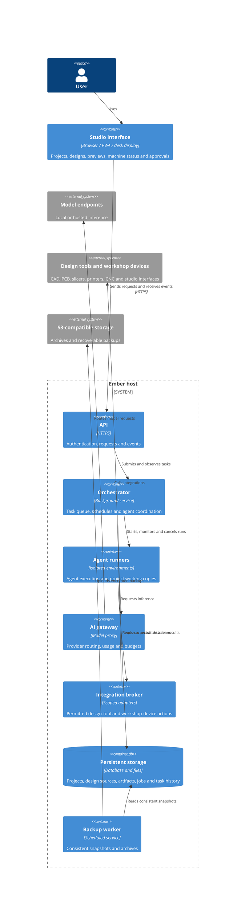

# Ember

Ember is a self-hosted AI design and fabrication workspace. It helps people
turn ideas into digital and physical artifacts by connecting design software,
fabrication tools, workshop devices, and useful physical interfaces in one
project-centered environment.

The primary workflow is to develop an idea, create or modify its design,
validate it, prepare a machine job, review and approve that job, operate the
connected equipment, and keep the source files and results together. AI
assistance, personal workflows, and conversational interfaces support this
making-centered purpose; they are not the product's organizing center.

This repository will provide the code and documentation needed to deploy, configure, and extend an independent Ember installation.

**Status:** design proposal. The capabilities below are planned requirements, not implemented features.

Implementation choices follow the [Go and library policy](decisions/004-go-and-library-policy.md).

## Goals

- Make the setup reproducible on user-controlled hardware.
- Support end-to-end design and fabrication projects through connected tools and devices.
- Provide a project-centered workspace for design files, machine jobs, previews, approvals, and results.
- Support multiple clients, agents, model providers, and optional workshop integrations.
- Keep primary data on the host; use S3-compatible storage for archives and backups.

## Architecture

The host runs the API, agents, tools, and persistent storage. Clients connect through an authenticated API. Model inference may run locally or through external providers.

Services may share one host. Model endpoints may run on that host or elsewhere. The diagram defines responsibilities, not a required deployment topology.

### Client–server contract

- Define HTTP endpoints, authentication, request schemas, responses, and errors in a versioned OpenAPI specification.
- Return a task ID for long-running work; expose status, results, and cancellation through the API.
- Stream task progress and notifications through server-sent events (SSE).
- Define event schemas and reconnection behavior; clients must recover task state after disconnecting.
- Specify streaming voice transport separately from the HTTP contract.
- Require authentication for client access and HTTPS for remote connections.

### Agent execution

- Assign each task an agent, model policy, workspace, tool permissions, and resource budget.
- Pass agents a project-persisted work definition covering the objective, scope,
  available tools, constraints, expected artifact formats, validation checks,
  and completion/reporting requirements.
- Keep the work definition portable across providers and model families; do not
  make project requirements depend on a vendor-specific prompt format.
- Require agents to save outputs in the project's declared formats and locations,
  preserve editable source alongside exports, and record provenance and validation
  results.
- Persist task state independently of client connections and agent processes.
- Bound concurrency, retries, execution time, CPU, memory, and disk usage.
- Give concurrent runs separate working copies; explicitly accept or merge their results.
- Record task IDs, model usage, tool calls, outcomes, and errors.
- Retry external actions only when they are idempotent or confirmed not to have taken effect.
- After a restart, resume recoverable work and mark interrupted runs explicitly.

### AI gateway

- Route agent model requests through a shared gateway.
- Select providers and models by task requirements, supported tools, context size, latency, and cost policy.
- Track input, output, and cached tokens where reported; label estimated usage and cost.
- Enforce request limits and configured per-task and per-period budgets.
- Account for concurrent in-flight requests when reserving budget; reconcile reservations against reported usage.
- Keep provider credentials in the gateway.
- Make fallback providers explicit; do not silently send data to another provider.
- Export request and policy events to a system-wide audit stream.
- Correlate gateway events with API, task, tool, process, filesystem, integration,
  and network activity, including traffic outside the gateway.
- Require configurable alerts for unapproved actions or destinations, abnormal
  usage, failures, and lost monitoring coverage.

See the [gateway monitoring requirements](decisions/003-ai-gateway-shortlist.md#mandatory-monitoring-and-alerting).

### Sandbox and permissions

- Run agent code outside the host control services, under an unprivileged identity.
- Expose only the assigned workspace and explicitly permitted resources.
- Exclude host credentials, unrelated directories, and container-runtime sockets.
- Deny outbound network access by default; allow only approved endpoints and brokered integrations.
- Keep integration credentials in host adapters rather than prompts or agent workspaces.
- Check permissions in host services; model instructions are not an authorization boundary.
- Require confirmation before starting a print or performing destructive host actions.
- Document isolation guarantees; use VM-backed isolation for workloads that require a stronger boundary than a shared host kernel.

## Memory and storage

- Store durable notes as editable Markdown with links, timestamps, and source references.
- Keep preferences, project decisions, and daily summaries distinct from task execution records.
- Mark uncertain or inferred claims; let users correct and delete stored notes.
- Retrieve relevant context before a task; do not send the entire archive to every model request.
- Start with full-text search; add semantic retrieval when needed.
- Treat search indexes as derived data that can be rebuilt from source records.
- Back up database snapshots, notes, project files, and configuration to S3-compatible storage.
- Encrypt backups, define retention, and keep recovery keys available independently of the host.
- Document and verify restoration onto a fresh host.

S3 is an archive and backup destination, not the live agent workspace. Hosted inference receives the context included in each request; self-hosting Ember does not make those requests local.

## Studio interface and assistance

- Provide a responsive workspace for desktop, tablet, and phone, organized around projects and making workflows.
- Support internationalization so users can choose the interface language, with translated UI strings kept separate from application logic.
- Include multiple built-in themes and allow users to customize the interface by installing community-provided CSS. Treat third-party CSS as untrusted styling, not as an extension or security boundary.
- Present design files, previews, machine readiness and status, job history, and approval requests alongside assistant chat.
- Support useful physical interfaces such as a desk-mounted touchscreen or planning display for sketches, project plans, previews, and machine status.
- Keep chat, shortcuts, calendar, and to-dos available as supporting tools rather than the primary product structure.
- Support reminders, research, and scheduled background work when they help advance a project.
- Add speech recognition and speech synthesis through replaceable local or hosted services.
- Show transcripts and support interrupting spoken output; cancelling the underlying task is a separate action.
- Show task completion, failures, monitoring alerts, reminders, and approval requests in a persistent notification inbox.
- Offer web push where supported and permitted; retain notifications for clients that were offline.
- Consider a PWA for installation and cached views; host-dependent actions still require a connection.
- Use an optional paired desktop companion for local application control, overlays, and multi-monitor panels.
- Keep a direct way to disable desktop integration and return to the normal desktop.

## Designer and fabrication workflows

The designer workspace connects engineering tools, project files, workshop
equipment, and generated artifacts. Projects should preserve editable sources
and a traceable path from design through fabrication.

- Define project artifact types, formats, naming, locations, versioning, and
  validation requirements in machine-readable project definitions.
- Prefer documented, open, tool-supported formats where practical; record
  required applications and versions where a native format is necessary.
- Use established formats and protocols where they fit the artifact: for
  example STEP or STL for 3D exchange, 3MF for richer 3D-print jobs, SVG or
  DXF for 2D geometry, and Gerber/Excellon for PCB fabrication. Preserve
  editable native sources as well; an interchange or machine format is not a
  substitute for the design source.
- Keep source artifacts separate from derived exports, previews, and machine
  jobs, while linking each derived item to its source revision and generation
  settings.
- Support CAD models, PCB layouts, schematics, and Blender scenes through tool-specific adapters.
- Keep editable source files, tool versions, and generated artifacts for each project revision.
- Maintain a reusable parts library with previews and source links.
- Use supported application APIs or command-line interfaces where available.
- Integrate with slicers, 3D printers, CNC machines, and other fabrication equipment through explicit, replaceable adapters.
- Validate generated files with the relevant tools before fabrication; show the operator the prepared job and preview.
- Require explicit approval before starting a print, CNC job, or other consequential machine operation.
- Track machine readiness, job progress, errors, and completion; retain job settings and outputs with the project.
- Follow a 3D-print workflow: design → validation → export → slicing → preview → approval → print → result.
- Follow an electronics workflow: schematic → PCB layout → design-rule checks → fabrication export.
- Treat a desk display or other physical studio interface as an optional client for plans, design previews, job review, and equipment status.

### Project definitions and agent work contracts

Each project may include a versioned, machine-readable definition describing
its purpose, structure, artifact types, preferred formats, required tools,
validation steps, and fabrication constraints. An agent task receives this
definition together with its specific work request and permissions.

See the proposed [agent project contract](agent-project-contract.md) for
illustrative project-definition and completion-report formats. The schema is a
design proposal and must be qualified against target applications before
implementation.

The definition is authoritative for project-specific requirements. Agents
should:

- Read the project definition and relevant instructions before changing files.
- Work only within assigned project paths and granted permissions.
- Preserve source files; do not replace editable sources with rendered or
  fabrication-only outputs.
- Save outputs to declared locations, use declared formats and naming rules,
  and avoid unrequested files.
- Run the specified validation tools when available, recording which checks
  passed, failed, or could not be run.
- Report changed files, generated artifacts, tool versions, validation results,
  assumptions, and unresolved issues in a structured completion report.
- Never start a printer, CNC, or other physical operation unless the task
  explicitly permits it and any required human approval has been obtained.

Project definitions should use a portable schema owned and versioned by Ember,
not a provider-specific agent configuration. Adapters may translate the work
contract into Claude, OpenAI, or local-model tool and instruction formats; the
project definition and saved artifacts remain the source of truth.

## Modules and integrations

- Keep calendar, weather, music, smart-home, design, and device integrations optional.
- Define each module's identifier, version, configuration schema, required permissions, and supported operations.
- Validate tool inputs and outputs against explicit schemas.
- Declare compatibility with the host API and check it during installation or upgrade.
- Run third-party executable modules outside the host control process, with scoped credentials and resource limits.
- Allow individual modules to be enabled, disabled, upgraded, and removed.

## Deployment and operations

- Pin dependencies and provide installation, configuration, upgrade, and recovery instructions.
- Provide an example configuration without credentials.
- Document hardware requirements separately for text-only, local voice, and local-model deployments.
- Expose service health, queue depth, storage usage, model usage, and backup status.
- Preserve user data across upgrades and document database migration and rollback constraints.

## Proposed milestones

| Stage | Deliverable |
| --- | --- |
| 1. Foundation | Reproducible host setup, authenticated project workspace, one model provider, project files, and a verified backup restore. |
| 2. First making loop | One design-tool integration and one end-to-end workflow that validates and exports a real artifact. |
| 3. Fabrication | Slicer and printer integration with job preview, explicit approval, status reporting, and a recorded result. |
| 4. Agent runtime | OpenAPI task endpoints, isolated tool execution, gateway budgets, progress events, and cancellation. |
| 5. Studio extensions | Additional CAD/PCB/Blender/CNC adapters, a desk-display client, and optional voice and personal-assistance features. |

Each stage requires setup instructions and a working end-to-end example before it is marked complete.

## Open decisions

- Supported host operating systems and deployment method.
- Agent runtime, initial model providers, and gateway implementation.
- Sandbox backend and required isolation level.
- Database, task queue, and first design-tool integrations.
