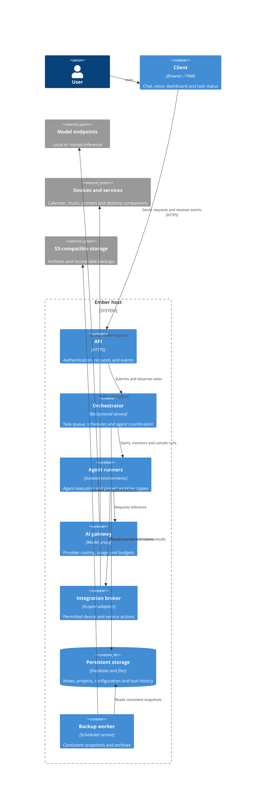

# Ember

Ember is a self-hosted personal assistant and engineering workspace inspired by [J.A.R.V.I.S.](https://en.wikipedia.org/wiki/J.A.R.V.I.S.) and Nik's home assistant.

This repository will provide the code and documentation needed to deploy, configure, and extend an independent Ember installation.

**Status:** design proposal. The capabilities below are planned requirements, not implemented features.

Implementation choices follow the [Go and library policy](decisions/004-go-and-library-policy.md).

## Goals

- Make the setup reproducible on user-controlled hardware.
- Provide persistent memory, personal assistance, and engineering workflows through one interface.
- Support multiple clients, agents, model providers, and optional integrations.
- Keep primary data on the host; use S3-compatible storage for archives and backups.

## Architecture

The host runs the API, agents, tools, and persistent storage. Clients connect through an authenticated API. Model inference may run locally or through external providers.

Services may share one host. Model endpoints may run on that host or elsewhere. The diagram defines responsibilities, not a required deployment topology.

### Client–server contract

- Define HTTP endpoints, authentication, request schemas, responses, and errors in a versioned OpenAPI specification.
- Return a task ID for long-running work; expose status, results, and cancellation through the API.
- Stream task progress and notifications through server-sent events (SSE).
- Define event schemas and reconnection behavior; clients must recover task state after disconnecting.
- Specify streaming voice transport separately from the HTTP contract.
- Require authentication for client access and HTTPS for remote connections.

### Agent execution

- Assign each task an agent, model policy, workspace, tool permissions, and resource budget.
- Persist task state independently of client connections and agent processes.
- Bound concurrency, retries, execution time, CPU, memory, and disk usage.
- Give concurrent runs separate working copies; explicitly accept or merge their results.
- Record task IDs, model usage, tool calls, outcomes, and errors.
- Retry external actions only when they are idempotent or confirmed not to have taken effect.
- After a restart, resume recoverable work and mark interrupted runs explicitly.

### AI gateway

- Route agent model requests through a shared gateway.
- Select providers and models by task requirements, supported tools, context size, latency, and cost policy.
- Track input, output, and cached tokens where reported; label estimated usage and cost.
- Enforce request limits and configured per-task and per-period budgets.
- Account for concurrent in-flight requests when reserving budget; reconcile reservations against reported usage.
- Keep provider credentials in the gateway.
- Make fallback providers explicit; do not silently send data to another provider.
- Export request and policy events to a system-wide audit stream.
- Correlate gateway events with API, task, tool, process, filesystem, integration,
  and network activity, including traffic outside the gateway.
- Require configurable alerts for unapproved actions or destinations, abnormal
  usage, failures, and lost monitoring coverage.

See the [gateway monitoring requirements](decisions/003-ai-gateway-shortlist.md#mandatory-monitoring-and-alerting).

### Sandbox and permissions

- Run agent code outside the host control services, under an unprivileged identity.
- Expose only the assigned workspace and explicitly permitted resources.
- Exclude host credentials, unrelated directories, and container-runtime sockets.
- Deny outbound network access by default; allow only approved endpoints and brokered integrations.
- Keep integration credentials in host adapters rather than prompts or agent workspaces.
- Check permissions in host services; model instructions are not an authorization boundary.
- Require confirmation before starting a print or performing destructive host actions.
- Document isolation guarantees; use VM-backed isolation for workloads that require a stronger boundary than a shared host kernel.

## Memory and storage

- Store durable notes as editable Markdown with links, timestamps, and source references.
- Keep preferences, project decisions, and daily summaries distinct from task execution records.
- Mark uncertain or inferred claims; let users correct and delete stored notes.
- Retrieve relevant context before a task; do not send the entire archive to every model request.
- Start with full-text search; add semantic retrieval when needed.
- Treat search indexes as derived data that can be rebuilt from source records.
- Back up database snapshots, notes, project files, and configuration to S3-compatible storage.
- Encrypt backups, define retention, and keep recovery keys available independently of the host.
- Document and verify restoration onto a fresh host.

S3 is an archive and backup destination, not the live agent workspace. Hosted inference receives the context included in each request; self-hosting Ember does not make those requests local.

## User interface and assistance

- Provide a responsive web interface for desktop, tablet, and phone.
- Include chat, shortcuts, calendar, to-dos, project access, and host and task status.
- Support reminders, morning briefs, research, and scheduled background work.
- Add speech recognition and speech synthesis through replaceable local or hosted services.
- Show transcripts and support interrupting spoken output; cancelling the underlying task is a separate action.
- Show task completion, failures, monitoring alerts, reminders, and approval requests in a persistent notification inbox.
- Offer web push where supported and permitted; retain notifications for clients that were offline.
- Consider a PWA for installation and cached views; host-dependent actions still require a connection.
- Use an optional paired desktop companion for local application control, overlays, and multi-monitor panels.
- Keep a direct way to disable desktop integration and return to the normal desktop.

## Designer

Designer connects engineering tools, project files, and generated artifacts in one workspace.

- Support CAD models, PCB layouts, schematics, and Blender scenes through tool-specific adapters.
- Keep editable source files, tool versions, and generated artifacts for each project revision.
- Maintain a reusable parts library with previews and source links.
- Use supported application APIs or command-line interfaces where available.
- Validate generated files with the relevant tools before fabrication.
- Follow a 3D-print workflow: design → validation → export → slicing → preview → approved print.
- Follow an electronics workflow: schematic → PCB layout → design-rule checks → fabrication export.

## Modules and integrations

- Keep calendar, weather, music, smart-home, design, and device integrations optional.
- Define each module's identifier, version, configuration schema, required permissions, and supported operations.
- Validate tool inputs and outputs against explicit schemas.
- Declare compatibility with the host API and check it during installation or upgrade.
- Run third-party executable modules outside the host control process, with scoped credentials and resource limits.
- Allow individual modules to be enabled, disabled, upgraded, and removed.

## Deployment and operations

- Pin dependencies and provide installation, configuration, upgrade, and recovery instructions.
- Provide an example configuration without credentials.
- Document hardware requirements separately for text-only, local voice, and local-model deployments.
- Expose service health, queue depth, storage usage, model usage, and backup status.
- Preserve user data across upgrades and document database migration and rollback constraints.

## Proposed milestones

| Stage | Deliverable |
| --- | --- |
| 1. Foundation | Reproducible host setup, authenticated web chat, one model provider, editable notes, and a verified backup restore. |
| 2. Agent runtime | OpenAPI task endpoints, isolated tool execution, multiple agents, gateway budgets, progress events, and cancellation. |
| 3. Assistance | Scheduled tasks, calendar integration, reminders, notifications, and morning briefs. |
| 4. Clients | Voice, PWA support where useful, and an optional desktop companion. |
| 5. Designer | One working CAD-to-export workflow, followed by slicing, printer, PCB, and Blender integrations. |

Each stage requires setup instructions and a working end-to-end example before it is marked complete.

## Open decisions

- Supported host operating systems and deployment method.
- Agent runtime, initial model providers, and gateway implementation.
- Sandbox backend and required isolation level.
- Database, task queue, and first design-tool integrations.
