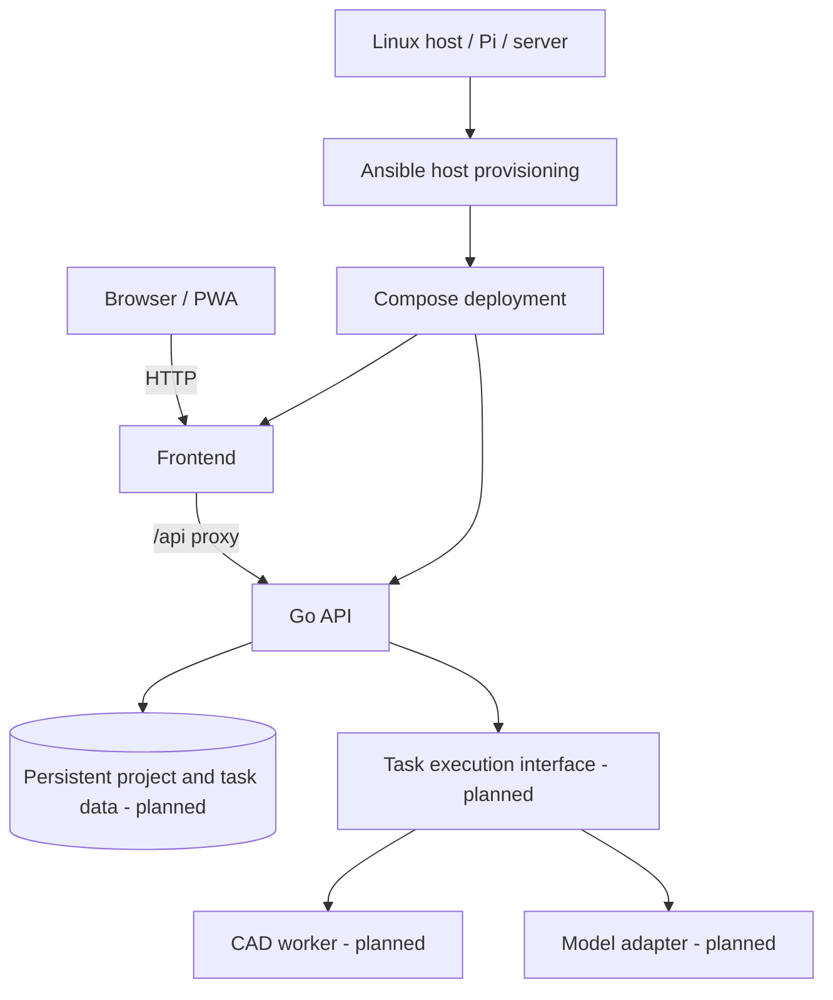

# Ember architecture

Start with the [engineering overview](overview.md) for the proposed component model,
[verified baseline](current-state.md) for runtime and deployment evidence, and
[decision register](../planning/human-decisions.md) for open commitments.

Ember is a portable software platform, separate from the host and physical
infrastructure on which it runs. The logical layers do not require separate
machines or independently deployed services.

## Implemented now

- `apps/api`: Go HTTP process exposing `GET /healthz` plus prototype project and
  plugin-configuration endpoints. Projects and their Markdown notes live on
  disk; plugin configuration is lost on restart. Optional OpenID Connect
  sign-in ([`internal/auth`](../authentication.md)) is off by default; without
  it there is no authentication. The Weather plugin proxies one
  fixed operation to Open-Meteo; the bundled Immich entry stores configuration
  only and does not call Immich.
- `apps/frontends/web`: the single browser frontend, an installable SvelteKit
  app: sign-in page, dashboard, linked Markdown project notes at
  `/apps/notes/`, plugins, settings, account and admin pages in one shell.
- `deploy/compose.yaml`: runs the API, the web frontend, and a gateway on one
  host. The gateway proxies `/api/` to the API and everything else to the
  frontend, and is published on loopback by default at `http://127.0.0.1:3000`.
  With sign-in on, `deploy/compose.oidc.yaml` configures the API and
  `deploy/compose.redis.yaml` adds a Redis session store on an internal
  network that only the API joins
  ([ADR 014](../decisions/014-redis-session-store.md)).
- `infra/ansible`: initial Debian/Ubuntu host preparation and Compose deployment.
  It installs Tailscale; an already-enrolled device gets a private Serve route,
  and first-time enrollment can use an auth key supplied through Ansible Vault.
- `contracts/openapi.yaml`: contract for health, projects, Markdown notes, and
  plugin discovery/configuration endpoints.
- `contracts/project-schema/`: initial portable project manifest schema.

## Planned boundaries

The AI worker, model adapter, and CAD worker have documented responsibilities
but are not running services yet. When implemented, they should communicate
through versioned contracts and task IDs, not through host paths or direct
database access.

Frontend and backend features should be modular and optional, with plugins
declaring their contracts and required capabilities. This is a design direction,
not an implemented plugin system. See [modularity](modularity.md) for boundaries,
compatibility rules, and the status of features mentioned in the supplied Ember
v2 review artifact.

The API owns authentication, authorization, project/task lifecycle, and
approvals. Model credentials belong to a trusted model adapter. Untrusted
generated code belongs in a separately constrained execution boundary. See the
[sandboxing overview](../sandboxing/README.md).

The longer-term plan for separately hosted personal applications and controlled
agent integrations is described in [shared self-hosted services](shared-services.md).
Those applications and their identity/ingress layer are not currently deployed
by Ember.

## Deployment portability

Compose is the initial deployment adapter for one host. Application contracts
must not depend on Compose, Docker, a specific Pi model, or a specific model
provider. Ansible provisions the host and deploys the Compose application;
it is not part of the application runtime. Kubernetes and multi-host scheduling
are deferred until there is a concrete need for them.

Ember services are deployed only as containers under Compose today. Kubernetes
is a future container-orchestration option; systemd units are not an Ember
deployment method.
