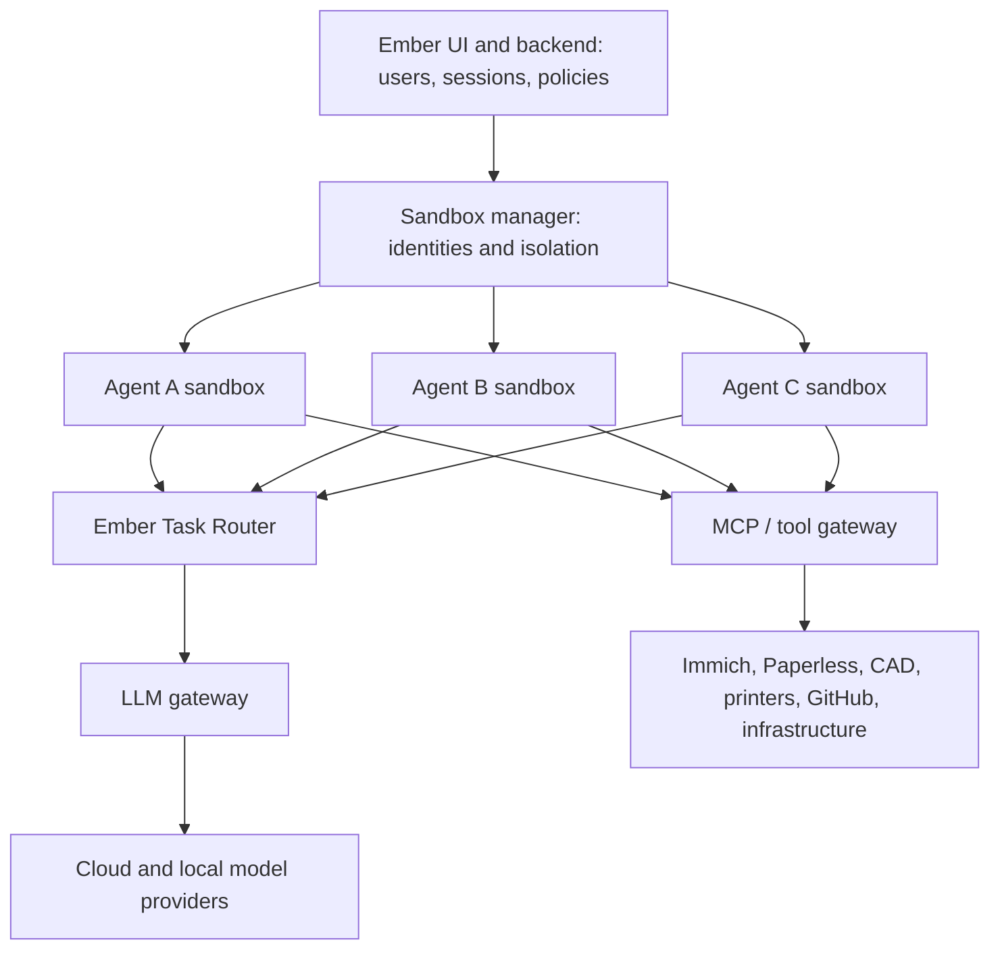

# Ember AI gateway architecture and evaluation

- **Status:** Proposed architecture; gateway selection is not final.
- **Purpose:** Define the boundaries, requirements, and evaluation plan for
  controlled model and tool access.

This page is a proposal, not a replacement for
[ADR 003](../decisions/003-ai-gateway-shortlist.md), which remains the current
gateway decision record. In particular, this page proposes Bifrost as the first
combined-gateway experiment, while ADR 003 recommends first establishing a
monitored provider adapter and conditionally comparing candidates. Resolve that
difference through a reviewed ADR update before adopting or deploying a gateway.

## 1. Context and goals

Ember is intended to provide one self-hosted interface for applications,
services, workflows, and AI agents, including Immich, Paperless-ngx, CAD and
fabrication tools, printers, GitHub, home infrastructure, external APIs, and MCP
servers.

Ember agents should run in isolated sandboxes. The gateway architecture should:

1. Provide secure access to LLM providers.
2. Provide controlled access to MCP tools and external APIs.
3. Route tasks to models based on task needs, privacy, and cost.
4. Support local and cloud models.
5. Track usage and spending.
6. Enforce per-agent, per-user, and per-instance permissions.
7. Support multiple Ember instances sharing infrastructure without sharing
   private data or authority.
8. Remain reproducible, maintainable, and self-hosted where practical.

The architectural aim is to balance flexibility and self-maintenance with
stability and security.

## 2. Core principle and boundaries

> **Agents request capabilities. Ember controls which models and tools satisfy
> those requests. Trusted infrastructure enforces access permissions.**

Agents must not store provider keys, choose unauthorized models, connect to
arbitrary MCP servers, modify their own permissions, bypass a gateway with
direct network access, or access host administration interfaces by default.

Keep two gateway responsibilities logically separate even if an initial
product implements both.

### LLM gateway

Potential responsibilities:

- Model/provider routing and API compatibility
- Rate limits and load balancing
- Token accounting, usage, cost, and budgets
- Failover and fallback
- Caching
- Observability

### MCP/tool gateway

Potential responsibilities:

- MCP server federation and tool discovery
- Tool-level permissions and execution
- API-to-MCP conversion
- Identity propagation
- Tool execution audit logs
- Integration with secrets and policy systems

Neither gateway replaces Ember's user identity, application authorization, or
the operating-system/container sandbox boundary.

## 3. Gateway candidates

The candidates below are for evaluation, not approval. Verify current feature
availability, licensing, security properties, maintenance, resource needs, and
ARM64 compatibility against upstream documentation and runtime tests before
selection.

### Bifrost

Repository: <https://github.com/maximhq/bifrost>

Combined LLM and MCP gateway. Candidate capabilities include multiple LLM
providers, an OpenAI-compatible API, virtual keys, budgets, load balancing,
failover, caching, MCP integration, observability, and role-scoped tool
execution.

**Potential advantages:** one service for an initial POC, fewer deployed
components, and an attractive combined-gateway experiment.

**Risks to verify:** broader dependency and failure domain; quality of the
security boundary; per-agent and per-tenant authorization; resource usage; and
Raspberry Pi/ARM64 support.

**Current recommendation:** primary candidate for an initial combined-gateway
experiment, subject to qualification. This is not an approved production
dependency.

### LiteLLM

Repository: <https://github.com/BerriAI/litellm>

LLM gateway/proxy candidate. Relevant capabilities include multiple providers,
virtual keys, model aliases, load balancing, fallbacks, budgets, per-key usage,
rate limiting, and cost accounting.

**Potential advantages:** specialization in LLM management, a provider-neutral
API, and support for local and cloud endpoints.

**Risks to verify:** deployment and operational requirements; licensing and
feature availability; and the need for a separate MCP/tool gateway.

**Current recommendation:** strong candidate for the LLM component in a
modular architecture.

### agentgateway

Repository: <https://github.com/agentgateway/agentgateway>

Agent traffic and MCP gateway candidate. Areas to evaluate include MCP
federation, tool and LLM routing, OAuth, agent-to-agent traffic, OpenAPI-to-MCP,
and traffic governance.

**Potential advantages:** agent-oriented communication and a potential
centralized tool-access boundary.

**Risks to verify:** operational and security maturity, resource requirements,
and feature overlap with the LLM gateway.

**Current recommendation:** candidate MCP gateway for a modular architecture.

### IBM ContextForge

Repository: <https://github.com/IBM/mcp-context-forge>

MCP federation and management candidate. Evaluate server federation, virtual
MCP servers, tool registration/discovery, API-to-MCP integration, and access
governance.

**Potential advantages:** fit for a large ecosystem of heterogeneous
integrations.

**Risks to verify:** operational cost, security model, deployment support, and
whether Ember needs centralized federation at POC scale.

**Current recommendation:** important alternative if integration federation
becomes a central requirement.

### Other candidates

- **Portkey AI Gateway:** evaluate routing, guardrails, observability, failover,
  licensing, self-hosted feature availability, and MCP scope.
- **Docker MCP Gateway:** a possible MCP container lifecycle/isolation
  companion, not an LLM gateway replacement.
- **Kong AI Gateway:** potentially relevant for larger-scale API governance;
  evaluate licensing and feature availability.

## 4. Requirements

### Critical

- Per-agent identities and per-user authorization
- Per-instance/tenant isolation
- Tool-level authorization
- Centralized provider credentials
- No unrestricted sandbox network access
- Audit logs and credential revocation
- Fail-closed authorization
- No direct infrastructure administration by default

### High priority

- Multi-provider model routing
- Task-aware model selection
- Local model support
- Token/cost accounting and hard budgets
- MCP federation and API-to-MCP conversion
- Tool discovery
- Fallbacks and rate limits
- Human approval for high-risk operations
- Prompt-injection risk mitigation
- Structured traces and metrics

### Medium priority

- Semantic caching
- Agent-to-agent communication
- GPU-aware inference routing
- Tool catalog search
- Privacy-aware routing
- Quality-based model escalation

### Future

- Multi-node model scheduling
- Predictive workload routing
- Automatic provider cost optimization
- Self-maintaining integration deployments
- Automated capability benchmarking
- Distributed agent orchestration

## 5. Task-aware model routing

Agents should request a logical capability/tier rather than select a
provider-specific model. Example aliases include `local`, `economy`, `balanced`,
`reasoning`, `coding`, and `vision`.

Illustrative Ember-owned configuration (not gateway-native configuration):

```yaml
model_routing:
  aliases:
    local:
      providers: [ollama]
    economy:
      providers: [cloud_economy, ollama]
    balanced:
      providers: [cloud_balanced]
    reasoning:
      providers: [cloud_reasoning]
    coding:
      providers: [cloud_coding]
```

The Ember Task Router should consider task type, complexity, privacy
requirements, user permissions, token/cost budget, latency, model capabilities,
provider availability, and historical task performance.

| Task | Preferred tier | Fallback |
| --- | --- | --- |
| Document classification | Local | Economy, only if policy allows |
| Document summarization | Local / economy | Balanced, only if policy allows |
| Metadata extraction | Local / economy | Balanced, only if policy allows |
| Simple code generation | Economy / coding | Balanced |
| Complex debugging | Reasoning | Authorized alternative reasoning model |
| CAD workflow planning | Reasoning | Human review |
| UI generation | Coding | Reasoning |
| Image analysis | Vision | Authorized alternative vision model |
| Routine status report | Local | Economy, only if policy allows |

Suggested routing flow:

1. Classify the task and required capabilities.
2. Resolve privacy and authorization policy.
3. Select the least-cost eligible tier.
4. Execute and validate where practical.
5. Escalate only within an explicit maximum retry count and budget.
6. Record model, usage, cost, latency, fallback, and outcome.

Validation itself costs resources, and not every response is automatically
verifiable. Sensitive tasks must never fall back to an unauthorized cloud
provider. A hard budget must stop uncontrolled spending.

## 6. Logical architecture



This is a logical view. A POC may combine both gateways using Bifrost. Network
policy must enforce approved gateway paths; application instructions alone do
not provide network isolation.

## 7. Security model

### Agent identity

Each execution should use a short-lived, scoped, revocable identity bound to a
user and task. The trusted backend/infrastructure issues and verifies it; a
sandbox cannot forge its permissions.

Illustrative policy context:

```yaml
agent_identity:
  ember_instance: ember-home-01
  user_id: user-123
  task_id: task-456
  agent_id: agent-789
  permissions:
    - paperless.documents.read
    - immich.photos.search
  limits:
    max_task_cost_usd: 0.50
    max_tool_calls: 30
    max_execution_seconds: 300
```

### Tool authorization

Authorization must be enforced by trusted backend or gateway code, not by
relying on the model to follow instructions. For example, one agent may have
`paperless.documents.read` but not `paperless.documents.delete`; another may
have CAD generation but no Paperless or infrastructure access.

### Network isolation

Sandbox policy should deny direct access to internal APIs, model providers,
infrastructure control planes, arbitrary MCP endpoints, host services, metadata
endpoints, container sockets, and host secrets. Allow only required gateway and
control endpoints. Exceptional access must be explicit and testable.

### Secrets

Keep provider credentials in trusted infrastructure. Prefer centralized secret
storage, short-lived/scoped credentials, per-instance integration credentials,
encryption at rest, rotation, and access audits. Never expose upstream provider
keys to sandboxes unless absolutely unavoidable.

### Human approval

Destructive or high-impact actions—such as deleting documents, modifying
infrastructure, deploying containers, changing firewalls, sending external
messages, or controlling physical devices—require explicit authorization bound
to the specific action and parameters.

## 8. Multiple Ember instances

Shared infrastructure may include model inference, gateway software,
monitoring, and public integration catalogs. Keep these isolated per instance:

- User identities and application credentials
- User-specific data and authorization policy
- Agent sandboxes
- Budgets and usage attribution
- Tenant-specific MCP sessions and private integration configuration

A shared gateway is a multi-tenant security boundary. Share it only after
testing tenant isolation. If it cannot enforce isolation reliably, deploy
separate gateway instances.

## 9. Dynamic tool discovery

Do not expose every integration's complete tool list to every agent. A future
flow can discover relevant tools for the task, apply authorization, and return
only permitted tool definitions. Authorization must still be checked at
execution time.

A tool catalog may record name, description, schema, owning integration,
required permissions, risk classification, data sensitivity, and approval
requirements.

## 10. Observability

Attribute usage across Ember instance, user, agent, task, model, provider, tool,
and integration. Potential metrics include tokens, cost, model/tool latency,
tool-call counts, retries, fallbacks, cache hits, authorization denials,
gateway failures, and task success.

Do not retain sensitive prompts or tool payloads by default. Support redaction
and configurable retention.

## 11. Architecture options

### Option A — Bifrost only

Ember → sandboxed agents → Bifrost → model providers, MCP servers, integrations.

**Advantages:** fewer components and operational overhead; attractive for a
small combined-gateway experiment.

**Disadvantages:** broader failure domain and combined security boundary.

**Suggested use:** initial POC candidate, after qualification.

### Option B — LiteLLM + agentgateway

Ember Task Router → LiteLLM → model providers; agents → agentgateway → MCP
servers/integrations.

**Advantages:** clearer separation, independent scaling, replaceable components.

**Disadvantages:** more services, configuration, and operations.

**Suggested use:** long-term modular architecture candidate.

### Option C — LiteLLM + ContextForge

Ember → LiteLLM for models and ContextForge for integration catalog/federation.

**Advantages:** centralized management for a large heterogeneous integration
ecosystem.

**Disadvantages:** more infrastructure and a separate security evaluation.

**Suggested use:** evaluate if integration federation becomes central.

## 12. POC evaluation plan

Target a Raspberry Pi running Ubuntu Server and configured with Ansible. A
gateway may run on the Pi while inference runs on another machine or in the
cloud. Do not assume the Pi should host local inference.

### Phase 1 — Gateway deployment

- Verify ARM64 compatibility, resource use, and license.
- Deploy one candidate with reproducible Compose configuration.
- Configure one cloud provider and, if hardware permits, one local provider.
- Test API compatibility and provider failure behavior.

### Phase 2 — Model routing

- Define logical model tiers.
- Implement a minimal Ember Task Router.
- Route simple and complex tasks to different eligible tiers.
- Enforce hard task budgets and record usage per task.

### Phase 3 — MCP integration

- Deploy one read-only Paperless integration (or documented lighter substitute).
- Expose it through the selected tool gateway.
- Create two distinct agent identities.
- Authorize one identity and verify the other is denied.
- Audit tool calls and denials.

### Phase 4 — Sandbox verification

- Run agents in isolated sandboxes.
- Deny direct access to Paperless and model-provider APIs.
- Permit only approved gateway routes.
- Verify credentials are absent from sandboxes.
- Test credential revocation and blocked infrastructure access.

### Phase 5 — Observability

- Attribute tokens and cost per agent/task.
- Record routing decisions, tool calls, and authorization outcomes.
- Measure latency, fallbacks, and task outcomes.

### Phase 6 — Compare architectures

Compare Bifrost, LiteLLM + agentgateway, and (if relevant) LiteLLM +
ContextForge for operational complexity, resource use, ARM64 support, security
and isolation quality, routing, MCP capability, observability, reproducibility,
and maintenance effort.

## 13. Success criteria

The gateway POC succeeds when:

1. An agent can access authorized cloud and local model endpoints through a
   controlled gateway API.
2. Ember selects different logical tiers based on task requirements.
3. Usage and costs are attributed to tasks and agents, with hard limits.
4. An authorized identity can use a read-only MCP integration.
5. An unauthorized identity is denied.
6. Sandboxes cannot bypass gateway authorization with direct network access.
7. Provider credentials remain outside sandboxes.
8. Provider fallback respects privacy policy and budgets.
9. Gateway configuration is reproducible through Ansible and Compose.
10. Redeployment does not require undocumented manual setup.
11. The design can extend to larger homelab infrastructure.
12. A second Ember instance does not gain access to the first instance's data,
    credentials, policy, or budget.

## 14. Open questions

- How are user identities propagated into tasks and temporary agent credentials
  issued/revoked?
- Which component is the final authorization authority?
- Should Ember own the capability registry, or should the MCP gateway?
- How are non-MCP APIs exposed, and which actions require approval?
- Does model selection belong in Ember's router or the gateway?
- How are task complexity, quality, and escalation measured?
- Should gateway infrastructure be shared between Ember installations?
- Where should GPU inference run, and should the Pi host only control-plane
  services?
- Which sandbox technology and network enforcement are appropriate?
- How will policies be tested automatically, including prompt-injection and
  malicious tool responses?

## 15. Recommendation and decision status

Evaluate Bifrost first as a combined gateway candidate for the Pi POC. Preserve
interfaces so the system can later separate into an Ember Task Router, LLM
gateway, MCP gateway, sandbox manager, identity/policy service, integration
registry, and observability components.

Evaluate LiteLLM + agentgateway as the modular alternative, and ContextForge if
integration federation becomes a primary requirement. Do not make Ember's
overall architecture dependent on one gateway product.

This recommendation does not approve a dependency or deployment. Record a
technology decision only after feature/licensing review, threat-model review,
ARM64/resource qualification, and authorization/isolation tests.

**Core principle:** Agents request capabilities. Ember decides how those
capabilities are fulfilled. Trusted infrastructure enforces permissions.
