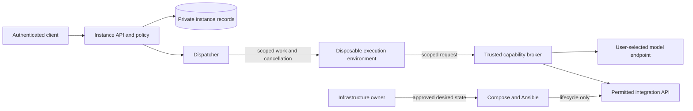

# Architecture overview

Ember is a self-hosted workspace for design and fabrication projects. Its purpose is to carry editable sources, decisions and validated outputs between tools and between people's chosen agents. The product proposal includes CAD, slicers, workshop devices and personal services. The first infrastructure POC in `EMBER_POC_IMPLEMENTATION_BRIEF.md` asks a narrower question: can two independent installations use the same service safely, without either becoming its administrator?

## The system you can inspect today

The browser requests `/api/healthz`; Nginx strips `/api` and uses Compose service DNS. The API reports its own process status, not the state of a worker, host or database. Ansible and the bundle installer are alternative setup paths, not runtime peers. See the [baseline and verification evidence](current-state.md) before attempting installation.

## Proposed component model

| Responsibility | Owner and interface | Reason for boundary |
| --- | --- | --- |
| User requests, ownership, policy, projects, job records | One Go API per Ember instance; versioned HTTP contract for clients | Keep authorization and transactional decisions together. Internal Go calls suffice for modules with the same trust and release lifecycle. |
| Service use | Reviewed adapter called with an authorized operation and a configured connection | Translate upstream errors and credentials at one edge. A connection can be removed without stopping the service. |
| Task execution | Dispatcher issues a bounded task grant; separate runner chosen by the operator | External processes may hang or execute untrusted input. The API should survive their failure. |
| Model access | Trusted adapter or qualified gateway, separate from authority to invoke tools | Providers are replaceable. Privacy, model eligibility and budgets constrain fallback; a model response cannot authorize a tool. |
| Service management | Operator via declared host configuration; possible separate controller later | Core and runners never own a container socket, SSH key or general infrastructure command interface. |

This second diagram is a **proposal**. The broker denotes trusted model/tool authorization paths, not one shared product. In the diagram the integration is infrastructure-managed; externally operated applications do not have an Ember lifecycle path at all. No agents execute today. The proposed [job lifecycle](agent-architecture.md) persists independently of a browser session, with grants checked again when tools execute.

## Deployment and growth

Start with a single Linux host, separate Compose project and port per instance, and a read-only integration. Do not require local model inference on a Pi. Move inference, conversion or hostile-code workloads to a measured, suitable host before scaling the control plane. Add a queue service or replicas only after persistence, recovery and contention measurements justify independent scheduling. A private network is not tenant isolation. See the [deployment and data model](deployment-model.md), [security model](security-model.md), [integration contracts](api-contracts-and-integrations.md) and [gateway evaluation](ai-gateway.md).

The [decision register](../planning/human-decisions.md) identifies what requires an owner: deployment target and first integration, identity, storage, sandbox profile, provider policy, lifecycle authority and service boundaries. Until those decisions are made, the [roadmap](../planning/roadmap.md) starts with a working, bounded health service and reproducible delivery.
