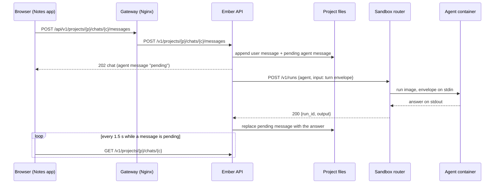

# Project chat with a sandboxed agent: implementation plan

**Date:** 2026-11-23  
**Status:** Proposed design. Phases P0–P7 are implemented on branch
`worktree-project-chat` and verified as recorded in the
[implementation log](../progress/implementation-log.md); P8–P13 are plans. The
**Status** column in the [phase table](#phases) records what exists in code.  
**Decision record:** [DEC-009](human-decisions.md#dec-009---agent-chat-from-the-web-api)

## Goal

A signed-in user opens a project in the Notes app, starts a chat with an agent
the operator has registered, and sends a message. Ember runs that agent **once**
in the sandbox router with the conversation so far, shows the agent's answer, and
saves the whole exchange as an ordinary file in the project.

The agent is whatever image the operator registered in the router policy. Ember
defines the input and output format, not the agent vendor, model, or session
format. This keeps "each person brings their own agent" possible.

## Non-goals for this iteration

These are deliberately left for the [later phases](#later-phases):

- Model access from inside the sandbox. The router runs agents with
  `--network=none`, so this iteration is proven end to end with an **offline
  fixture agent**. A real model needs the gateway route in P9.
- Streaming tokens, tool calls, approvals, or an agent editing project files.
- Per-user agents and credentials, and per-user attribution of messages.
- Durable task records (PostgreSQL, DEC-003) and recovery of runs across an API
  restart.
- Running the router inside the Compose deployment (P8).

## Baseline (commit `8464612`)

| Piece | State |
| --- | --- |
| Notes PWA (`apps/frontends/web`) | Projects and Markdown notes only. No chat screen. |
| API (`apps/api`) | Health, sign-in, projects, notes, service links, plugins. No agent or chat routes. |
| Sandbox router (`services/sandbox-router`) | Prototype. `POST /v1/runs {"agent","input"}` runs one registered image once: stdin task, stdout answer. Operator-only Unix socket, not in Compose, not connected to the API. |
| Review panel (`apps/api/cmd/agent-panel`, `services/ai-worker/opencode`) | Separate operator-only prototype: one password-protected page drives one OpenCode session in Kata, which reaches the operator's model only through a fixed `POST /v1/chat/completions` route on an internal network. Not part of the Ember UI or projects. |
| Model gateway | LiteLLM selected for a pilot (DEC-007). Not deployed. |

## Constraints that shape the design

| Constraint | Source | Consequence |
| --- | --- | --- |
| The API server's `WriteTimeout` is 15 s; a router run may take 60 s. | `apps/api/main.go`, router `runtime.go` | A send request cannot wait for the answer. **Runs are asynchronous**: the API accepts the message (`202`), runs the agent in the background and the browser polls the chat. |
| The router runs one job at a time and answers `429` when busy. | router `main.go` | The API holds one run slot and refuses a second send with `429 agent_busy` before saving anything. |
| Router input is a 32 KiB JSON body; output is capped at 64 KiB. | router `main.go`, `runtime.go` | The API fits the conversation into 32 KiB by leaving out the oldest messages and tells the agent how many it left out. |
| No job is enabled by default (DEC-004). | [DEC-004](human-decisions.md#dec-004---execution-threat-class-and-placement) | Chat runs exist only when the operator supplies an agents configuration file. Without it the routes report `agents_unavailable`. |
| "Do not add a public unauthenticated job endpoint." | [Roadmap](roadmap.md) | With agents configured, the API **refuses to start while sign-in is off**, unless the configuration sets `allowWithoutSignIn` for loopback development. |
| Project files are the source of truth (ADR 009); task records belong in PostgreSQL (DEC-003). | [ADR 009](../decisions/009-project-file-storage.md) | The transcript is a project file written through `projectfiles`. Run state (which run is in flight) is held in memory only and is not a task record. A run that was in flight when the API stopped is shown as interrupted. |
| Standard library only (ADR 004/005). | [ADR 004](../decisions/004-go-and-library-policy.md) | The router client is `net/http` over a Unix socket. No MCP or provider SDK. |
| Instructions are not a security boundary. | [Sandboxing](../sandboxing/README.md) | The sandbox profile, network policy and limits are enforced by the router, never by text in the envelope. |

## Request flow



## Design

### Operator configuration

`EMBER_AGENTS_CONFIG_FILE` names a JSON file. Unset means chat runs are off.

```json
{
  "routerSocket": "/run/user/1000/ember-router/router.sock",
  "allowWithoutSignIn": false,
  "agents": [
    {"id": "chat-fixture", "name": "Offline fixture"}
  ]
}
```

- `routerSocket`: absolute path of the router's Unix socket.
- `agents`: 1–16 entries. `id` must match the router policy name pattern
  `^[a-z][a-z0-9-]{0,62}$` and be registered in the router's policy. `name` is
  the label shown to users (1–80 characters).
- `allowWithoutSignIn`: defaults to `false`. With sign-in off and this `false`,
  the API exits at startup with an explanation.
- Unknown fields, duplicates and a file over 64 KiB are startup errors.

The API cannot list the router's policy, so an `id` the router does not know
fails at run time with `unknown_agent`.

### HTTP contract

Defined first in `contracts/openapi.yaml`. All routes are unprefixed in Go and
reached as `/api/...` through the gateway.

| Route | Purpose | Success | Errors |
| --- | --- | --- | --- |
| `GET /v1/agents` | Whether chat runs are on, and the registered agents | `200 {"enabled", "agents":[{"id","name"}]}` | — |
| `GET /v1/projects/{projectId}/chats` | Chat summaries, newest first | `200 {"chats":[ChatSummary]}` | `404 project_not_found` |
| `POST /v1/projects/{projectId}/chats` | Start a chat with an agent | `201 Chat` | `400 invalid_chat`, `400 unknown_agent`, `404 project_not_found`, `413 chat_limit`, `503 agents_unavailable` |
| `GET /v1/projects/{projectId}/chats/{chatId}` | One chat with all messages | `200 Chat` | `404 project_not_found`, `404 chat_not_found` |
| `POST /v1/projects/{projectId}/chats/{chatId}/messages` | Send a message; starts one agent run | `202 Chat` | `400 invalid_message`, `404 …`, `409 chat_busy`, `413 message_too_large`, `413 chat_full`, `429 agent_busy`, `503 agents_unavailable` |

Reading chats works while runs are off, because transcripts are project files.
Chat routes exist only on the file-backed handler, like the notes routes.

`GET /v1/agents` and every chat route need the `user` role
(`internal/auth/roles.go`); a request without a role gets
`403 insufficient_role`. Roles are not scoped to projects yet.

### Transcript file (`chats/<chatId>.json`)

Each chat is one JSON file beside the project's `notes/`, written atomically
through `projectfiles`:

```json
{
  "schema": "ember.chat/v1",
  "id": "3f9c2a7b1d4e8f60",
  "title": "Which filament for the bracket?",
  "agent": "chat-fixture",
  "created": "2026-11-23T10:00:00Z",
  "updated": "2026-11-23T10:00:04Z",
  "messages": [
    {"id": "a1b2c3d4e5f60718", "role": "user", "content": "Which filament…?", "created": "2026-11-23T10:00:00Z"},
    {"id": "0918f7e6d5c4b3a2", "role": "agent", "status": "completed", "run": "ember-run-…",
     "content": "PETG, because…", "created": "2026-11-23T10:00:00Z"}
  ]
}
```

- `role` is `user` or `agent`. Agent messages carry `status`: `pending`,
  `completed` or `failed`. A failed message has a user-facing `error` and no
  content.
- `run` is the router's run ID, so an operator can find the run in the router
  log. The transcript never stores host paths or raw router errors.
- IDs are 16 lowercase hex characters from `crypto/rand`.
- The file stays readable without Ember or any provider. The `agent` field is
  the operator's agent ID, not a vendor or model name.

### Turn envelope (agent stdin) and answer (stdout)

The router contract stays "one UTF-8 task on stdin, a text result on stdout".
For chat, the task text is this JSON document:

```json
{
  "schema": "ember.chat-turn/v1",
  "project": {"id": "desk", "name": "Desk organizer"},
  "chat": {"id": "3f9c2a7b1d4e8f60", "title": "Which filament for the bracket?"},
  "messages": [
    {"role": "user", "content": "Which filament…?"}
  ],
  "omittedMessages": 0
}
```

- `messages` holds user messages and **completed** agent messages, oldest
  first. The last entry is always the new user message.
- If the router request would exceed 32 KiB, the oldest messages are left out
  and `omittedMessages` says how many. A new message that cannot fit on its own
  is rejected with `413 message_too_large` before anything is saved.
- The agent prints its answer (plain text or Markdown) on stdout and exits 0.
  Ember trims it, replaces invalid UTF-8, and treats an empty answer as a
  failure.
- A wrapper in the image translates the envelope to its CLI's prompt format.
  The envelope is data. It does not grant tools, files or network access.

### Run lifecycle

1. Validate the message (non-empty after trimming, valid UTF-8, no NUL,
   ≤ 16 KiB).
2. Refuse with `409 chat_busy` if this chat already has a run in flight.
3. Take the API's single run slot or refuse with `429 agent_busy`.
4. Build the envelope and check that it fits.
5. Append the user message and a `pending` agent message, and save the file.
6. Return `202` with the chat.
7. In the background, call the router with a 90 s deadline. The router's own
   limit is 60 s.
8. Replace the pending message with the answer or a sanitized error, save, and
   release the slot.

On shutdown the API cancels in-flight runs, which also stops the container
(the router stops a run when its client disconnects). It waits up to 3 s to
record them as interrupted. A `pending` message without a run in memory, for
example after a crash, is shown as `failed` / interrupted, and the file is
corrected on the next write.

### Limits

| Limit | Value | Reason |
| --- | --- | --- |
| User message | 16 KiB UTF-8 | Fits the 32 KiB router request after JSON escaping |
| Agent answer | 64 KiB | Router stdout cap |
| Chat file | 1 MiB | Bounds reads and the listing cost; `413 chat_full` asks for a new chat |
| Chats per project | 100 | Bounds the listing; `413 chat_limit` |
| Runs in flight | 1 per API instance, 1 per chat | Router has one slot |
| Run deadline | 90 s at the API, 60 s at the router | Covers container start-up |
| Router response read | 1 MiB | 64 KiB of output after JSON escaping |
| Client polling | every 1.5 s while pending | No streaming yet |

### Errors shown to users

The router's error text can name runtimes and exit codes. Ember maps it to a
fixed message and logs the status and run ID instead.

| Router outcome | Stored `error` |
| --- | --- |
| Socket unreachable | The sandbox router is not reachable. Ask the operator to start it. |
| `404` | This agent is not registered with the sandbox router. |
| `429` | The sandbox runner is busy with another run. Try again shortly. |
| `504` or API deadline | The agent did not answer within the time limit. |
| `502`, other status | The agent run failed. The operator can look up the run ID in the router log. |
| Empty answer | The agent finished without an answer. |
| API shutdown | The run was interrupted before the agent answered. |

### Security notes

- Anyone who can call the send route can make the operator's host start a
  container. That is why runs need sign-in by default and are off until the
  operator configures them. Roles are not scoped to projects yet. Any signed-in
  user may chat in any project.
- The router still enforces the sandbox: profile chosen by the operator,
  `--network=none`, read-only root, dropped capabilities, no project mounts, and
  CPU, memory, PID and time limits. Untrusted coding agents must be registered
  under `isolated` (Kata).
- The API never forwards router error bodies, never logs message text, and
  writes only `chats/*.json` in the project.
- Transcripts may contain whatever users paste. They live with the project and
  are as private as its notes.
- Once P9 gives agents a model route, message text leaves the host for the
  configured model provider. DEC-007 governs that, not this plan.

### Frontend

The Notes app gains a **Chats** list under the notes list when `GET /v1/agents`
reports `enabled`, or when the project already has chats. **New chat** asks for
an agent when there is more than one. The chat view shows the transcript (agent
text in a pre-wrapped block, not rendered HTML), a message box and **Send**. While a
message is pending it shows "Agent is working…" and polls. Errors appear inline
on the failed message. `?project=…&chat=…` deep-links to a chat.

## Phases

| ID | Deliverable | Files | Acceptance evidence | Status |
| --- | --- | --- | --- | --- |
| P0 | This plan and DEC-009 | `docs/planning/project-chat.md`, `docs/planning/human-decisions.md` | Docs build passes | Done |
| P1 | HTTP contract | `contracts/openapi.yaml` | Routes, schemas and error codes written before code | Done |
| P2 | Agents package: configuration, envelope fitting, router client | `apps/api/internal/agents/` | Unit tests: config validation, fitting and omission, 32 KiB boundary, Unix-socket client against a fake router, status → error mapping, response caps | Done |
| P3 | Transcript storage | `apps/api/internal/projects/chats.go` | Unit tests: create, list, read, update; limits; schema and ID checks; symlinked `chats/` rejected | Done |
| P4 | Handlers, run manager, startup wiring | `apps/api/internal/httpapi/chats.go`, `server.go`, `main.go` | `httptest` with a fake runner: 202 then completed; busy chat 409; second chat 429; failure mapping; interruption on close; stale pending shown as interrupted; sign-in gate at startup; `go vet`, `go test -race` | Done |
| P5 | Notes app chat UI | `apps/frontends/web/src/` | `npm run check` passes; manual run against a local API | Done |
| P6 | Offline chat fixture agent | `services/sandbox-router/chat-fixture/` | Python unit test of the wrapper; local end-to-end: router (`trusted`, rootless Podman) → API → curl shows a completed answer | Done |
| P7 | Operator guide and evidence | `docs/project-chat.md`, `docs/progress/implementation-log.md` | Exact commands, platform and unexecuted checks recorded | Done |

### Later phases

| ID | Deliverable | Depends on |
| --- | --- | --- |
| P8 | **Compose deployment.** The router stays a host process, because it needs Podman or Docker. Add a router `-client-group` option (socket `0660`, directory `0710`, owned by the operator, group shared with the API container). Add an overlay `deploy/compose.agents.yaml` that bind-mounts the socket directory and the agents config and adds `group_add`, plus installer, bundle and Ansible wiring. Check all three Compose entry points (ADR 008). | DEC-009 |
| P9 | **Model route for sandboxed agents.** Let the operator give a router agent an internal network instead of `--network=none`, where the only other member is a model gateway with one fixed route. The review panel's `model-gateway` (Nginx, `POST /v1/chat/completions` only, no forwarded credentials) is the existing pattern; LiteLLM with per-agent virtual keys issued and revoked outside the image is the target. This is gateway Phase 4 in the [AI gateway plan](../architecture/ai-gateway.md). | DEC-007, DEC-009 |
| P10 | **Project context.** Stage selected notes (index, handoff) into the envelope or use isolated snapshot runs, and accept file changes only through a reviewed publish, like `ember-notes publish`. | P9 |
| P11 | **Identity.** Record the author's subject on user messages, and scope chats and agents per user or project. Routes already require the `user` role. | Project-scoped roles, DEC-002 |
| P12 | **Durable runs.** Task and run records in PostgreSQL, a job queue on NATS, recovery after restart, more than one runner slot, and streaming progress. | DEC-003, roadmap M6 |
| P13 | **Audit and monitoring.** Run events with user, agent, project, outcome and duration, sent to the monitoring required by ADR 003. | ADR 003 |

## Verification plan

The host used for this work has no Go toolchain, so Go checks run in the pinned
`golang:1.27.4` image with Podman:

```sh
# from the repository root
podman run --rm -v "$PWD":/src:Z -w /src/apps/api \
  docker.io/library/golang:1.27.4@sha256:205c7636d74e0ffbe3d007162df7d74f859f5a8c8322dfb9f907977686c126cf \
  sh -c 'gofmt -l . && go vet ./... && go test -race ./...'
```

Then the frontend type check, the Python wrapper test, the docs build, and one
local end-to-end run (router, API, fixture image, curl). A passing handler test
says nothing about the router, the installer or Compose. The progress log
records which checks ran.

## Rollback

Remove `EMBER_AGENTS_CONFIG_FILE` and restart the API: runs stop, and the chat
list stays readable. Reverting the branch removes the routes. Transcripts
remain as `chats/*.json` files in each project and can be deleted by hand.
